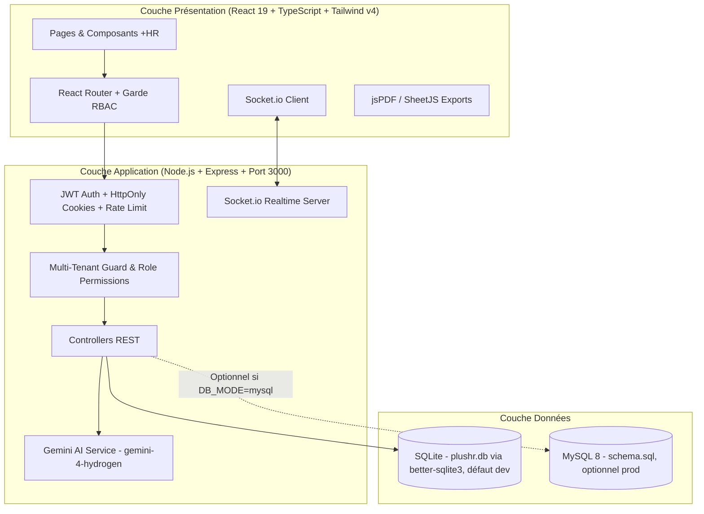
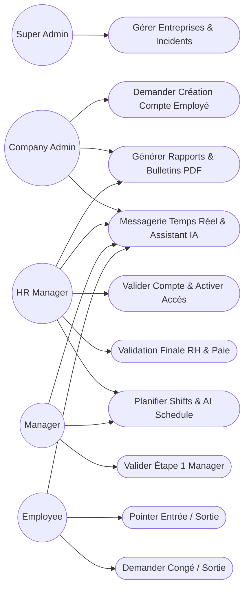
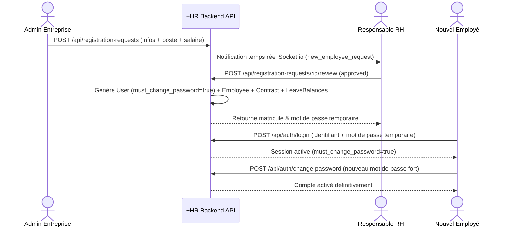
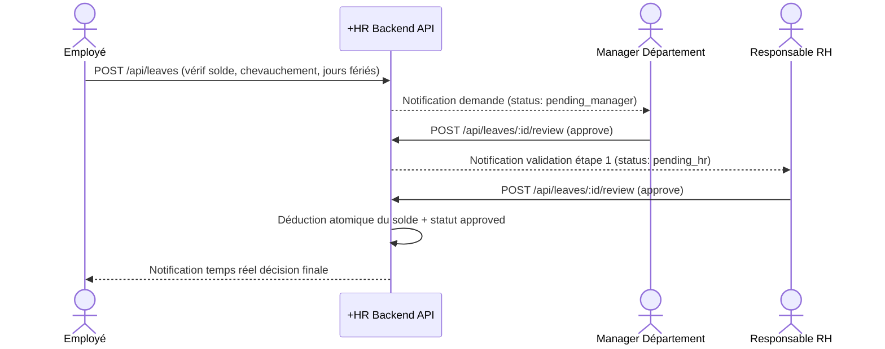

# Architecture, ERD (47 Tables) & Diagrammes UML — +HR

## 1. Diagramme d'Architecture 3-Tiers

---

## 2. Modèle Entité-Association (ERD — Vue Globale des 47 Tables)

```mermaid
erDiagram
  COMPANIES ||--o{ SUBSCRIPTIONS : has
  COMPANIES ||--o{ COMPANY_SETTINGS : configures
  COMPANIES ||--o{ USERS : employs_accounts
  COMPANIES ||--o{ DEPARTMENTS : organizes
  COMPANIES ||--o{ EMPLOYEES : contains
  ROLES ||--o{ USERS : assigns
  ROLES ||--o{ ROLE_PERMISSIONS : grants
  PERMISSIONS ||--o{ ROLE_PERMISSIONS : defines
  DEPARTMENTS ||--o{ POSITIONS : defines
  DEPARTMENTS ||--o{ EMPLOYEES : hosts
  EMPLOYEES ||--o{ CONTRACTS : signs
  EMPLOYEES ||--o{ ATTENDANCE_RECORDS : logs
  ATTENDANCE_RECORDS ||--o{ ATTENDANCE_CORRECTIONS : tracks
  EMPLOYEES ||--o{ LEAVE_BALANCES : holds
  LEAVE_TYPES ||--o{ LEAVE_BALANCES : categorizes
  EMPLOYEES ||--o{ LEAVE_REQUESTS : submits
  EMPLOYEES ||--o{ EXIT_REQUESTS : submits
  EXIT_TYPES ||--o{ EXIT_REQUESTS : categorizes
  SHIFTS ||--o{ SHIFT_ASSIGNMENTS : schedules
  EMPLOYEES ||--o{ SHIFT_ASSIGNMENTS : assigned_to
  PROJECTS ||--o{ TASKS : groups
  TASKS ||--o{ TASK_ASSIGNMENTS : assigns
  EMPLOYEES ||--o{ TASK_ASSIGNMENTS : works_on
  PAYROLLS ||--o{ PAYROLL_ITEMS : contains
  PAYROLL_ITEMS ||--|| PAYSLIPS : generates
  ANNOUNCEMENTS ||--o{ ANNOUNCEMENT_COMMENTS : receives
  MEETINGS ||--o{ MEETING_PARTICIPANTS : invites
  CONVERSATIONS ||--o{ CONVERSATION_MEMBERS : includes
  CONVERSATIONS ||--o{ MESSAGES : stores
  USERS ||--o{ NOTIFICATIONS : receives
  USERS ||--o{ AI_CONVERSATIONS : initiates
  AI_CONVERSATIONS ||--o{ AI_MESSAGES : records
  DEPARTMENTS ||--o{ AI_SCHEDULE_SUGGESTIONS : targets
```

> Le DDL SQL complet des **47 tables** (`companies`, `subscriptions`, `roles`, `permissions`, `role_permissions`, `users`, `password_reset_otps`, `refresh_tokens`, `audit_logs`, `company_settings`, `holidays`, `departments`, `positions`, `employees`, `employee_registration_requests`, `employee_documents`, `attendance_records`, `attendance_corrections`, `leave_types`, `leave_balances`, `leave_requests`, `exit_types`, `exit_requests`, `approval_history`, `shifts`, `shift_assignments`, `projects`, `tasks`, `task_assignments`, `task_comments`, `contracts`, `contract_alerts`, `payrolls`, `payroll_items`, `payslips`, `announcements`, `announcement_comments`, `meetings`, `meeting_participants`, `calendar_events`, `conversations`, `conversation_members`, `messages`, `notifications`, `notification_preferences`, `ai_conversations`, `ai_messages`, `ai_schedule_suggestions`, `technical_incidents`) se trouve dans [`database/migrations/schema.sql`](../database/migrations/schema.sql).

---

## 3. Diagramme de Cas d'Utilisation UML

---

## 4. Diagrammes de Séquence UML

### 4.1 Workflow d'Onboarding Employé en 6 Étapes

### 4.2 Workflow de Validation de Congé en 2 Étapes

